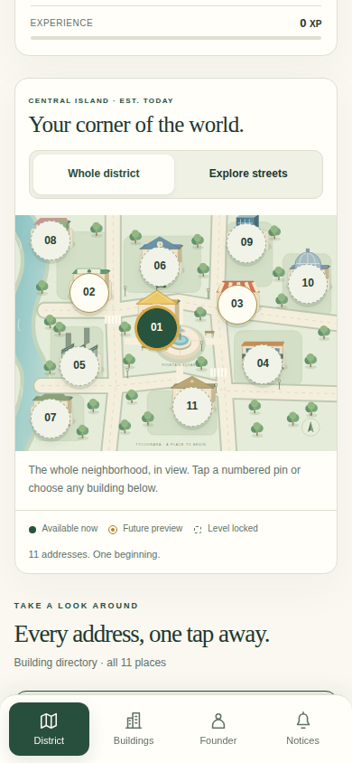
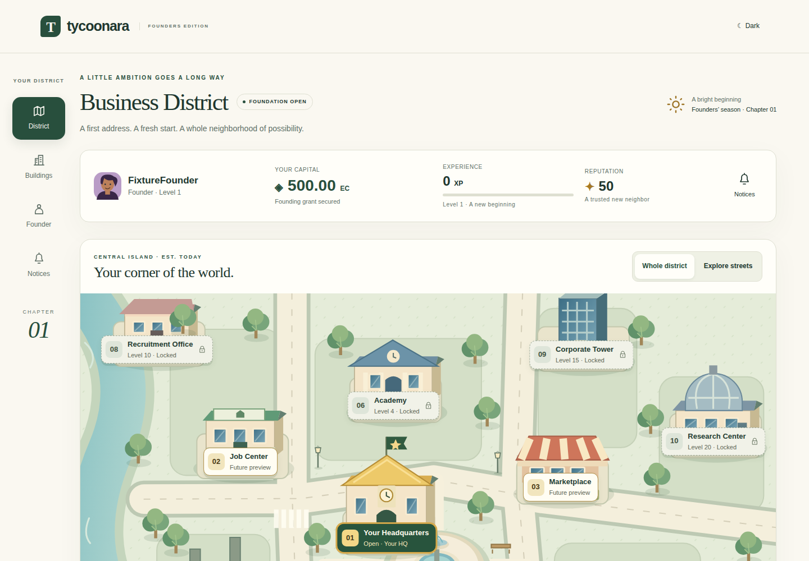

# Stage 1 district UI review

Synthetic founder fixture only. No production accounts or private data. Browser captures use the actual application layout and the same pinned Chromium/Next renderer for both revisions. Before: `5188af93374b6d70a9124811c10653a28fa638ab`. After: `ef9fe14d62af53074d37d21686d9ab989dfbaa06`.

| View | Before | After |
| --- | --- | --- |
| Mobile 390, light | [Before](before-mobile-390-light.png) | [After](after-mobile-390-light.png) · [Map](after-mobile-390-light-overview.png) |
| Mobile 390, dark | [Before](before-mobile-390-dark.png) | [After](after-mobile-390-dark.png) · [Map](after-mobile-390-dark-overview.png) |
| Desktop 1440, light | [Before](before-desktop-1440-light.png) | [After](after-desktop-1440-light.png) |
| Desktop 1440, dark | [Before](before-desktop-1440-dark.png) | [After](after-desktop-1440-dark.png) |

Mobile light overview:

Desktop light:

The complete 34-image set includes 320/360/390/430 mobile and 1440 desktop, both themes, full-page captures, exploration and building panels. Download `district-before-after-screenshots` from [the screenshot workflow](https://github.com/alexa-like/tycoonara/actions/runs/39213137722). Artifacts expire after 30 days; the comparison images above are committed for lasting review.

Touch-device Chromium emulation was used; physical Android and hosted SMTP/redirect verification remain manual checks.
