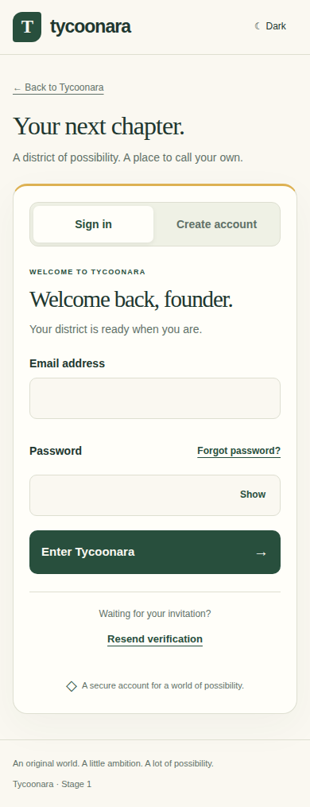
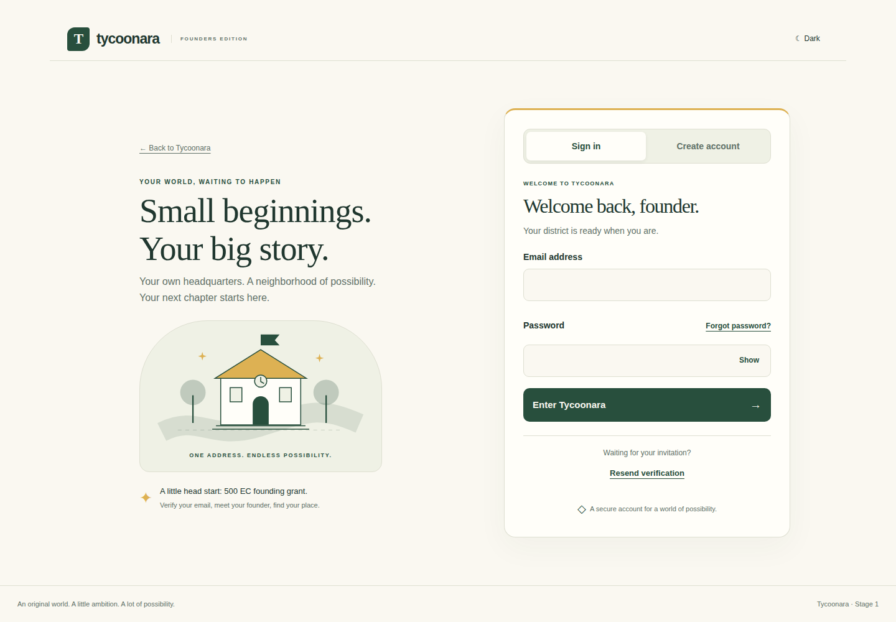

# Stage 1 authentication review

Addresses the [mobile authentication acceptance review](https://github.com/alexa-like/tycoonara/pull/2#issuecomment-6262005743). All five screens use the production components and layout. Before/after comparisons use production builds of the same pinned renderer, without development UI widgets. The before/after images use a separate visual test application with synthetic data; its password-update fixture does not bypass the protected production route. Real local Supabase interactions are tested and captured separately.

The layout starts with one column and a full-width form. Two columns begin at 980px, where the form retains its usable width. The only prominent mode choices are Sign in / Create account. Password recovery sits by the password label; verification help remains discoverable and becomes contextual after registration, failed verification or expired links. Inputs use 16px text, 52px height, and password visibility controls. Mode changes retain email, clear stale feedback/passwords, and move keyboard focus to the next step. Pending submissions disable repeated actions and feedback receives focus.

## Before and after

| View | Before | After |
| --- | --- | --- |
| Phone 390, light | [Sign in](before-mobile-390-light-signin.png) | [Sign in](after-mobile-390-light-signin.png) |
| Phone 390, dark | [Sign in](before-mobile-390-dark-signin.png) | [Sign in](after-mobile-390-dark-signin.png) |
| Desktop 1440, light | [Sign in](before-desktop-1440-light-signin.png) | [Sign in](after-desktop-1440-light-signin.png) |
| Desktop 1440, dark | [Sign in](before-desktop-1440-dark-signin.png) | [Sign in](after-desktop-1440-dark-signin.png) |

## Mobile screens

| Screen | Light | Dark |
| --- | --- | --- |
| Registration | [Create account](after-mobile-390-light-signup.png) | [Create account](after-mobile-390-dark-signup.png) |
| Password recovery | [Reset](after-mobile-390-light-reset.png) | [Reset](after-mobile-390-dark-reset.png) |
| Email verification | [Verify](after-mobile-390-light-resend.png) | [Verify](after-mobile-390-dark-resend.png) |
| Password update | [Update](after-mobile-390-light-update.png) | [Update](after-mobile-390-dark-update.png) |

## Verification and limitations

The responsive suite covers 320, 360, 390, 430, 768, 1024 and 1440 CSS pixels in both themes: single-column fit, form width, no horizontal overflow, 44px targets, native email/password validation, password visibility, mode focus and navigation, recovery, verification, expired links, updated-password notice, short viewport scrolling and Axe WCAG checks. The full real-local-Supabase suite separately exercises pending submissions, invalid credentials, signup, resend, captured verification email, onboarding, persisted district, sign-out, password recovery/update and re-login on mobile and desktop in both themes. Existing district, SQL/RLS and concurrency regressions also run.

These are Chromium touch emulations, not physical Android screenshots. Hosted SMTP delivery, provider email limits, email templates and allowed redirect settings remain unverified. No hosted auth configuration, database schema, ledger/grant semantics or production release guard was changed. Nothing was merged or released to production; Stage 2 remains untouched.

Browser traces and automatic failure screenshots remain disabled. Explicit captures contain only safe visual fixtures or isolated local test users; no hosted cookies, email tokens or credential files are recorded.

CI uses the app's existing `/auth/confirm` route for both initial and resent verification emails. The isolated checkout configures `tests/email/confirmation.html` as its confirmation template; the committed Supabase config and hosted project settings are unchanged. This avoids the default resent email's implicit-token redirect, which the server-only callback intentionally does not consume. Recovery still exercises the existing PKCE callback. Before hosted acceptance, confirm the signup template points to `https://YOUR_ORIGIN/auth/confirm?token_hash={{ .TokenHash }}&type=signup` and that the intended origin is allowed. This is already covered by the root README's SSR email guidance.

## Final evidence

Tested application revision: `7d222a631770b2f3b26fd15a54aa873e21eef8c9`. Before revision: `3ff09ae9df804e5219ffd2cb00f973c7bb68736e`. [All four CI jobs passed](https://github.com/alexa-like/tycoonara/actions/runs/39221011594): lint, typecheck, production builds, four unit tests, zero-vulnerability dependency audit, SQL/RLS/ledger tests, concurrent grants, and 30 browser tests. The 24 skipped cases are deliberate viewport/project combinations; each viewport is executed once in its appropriate touch or desktop project.

- [All 80 before/after auth screenshots](https://github.com/alexa-like/tycoonara/actions/runs/39221011594/artifacts/12172410358)
- [28 real local Supabase interaction screenshots](https://github.com/alexa-like/tycoonara/actions/runs/39221011594/artifacts/12171708298): credential errors, signup, resend, recovery, password update and saved-password notice, both themes on mobile and desktop.
- [District regression screenshots](https://github.com/alexa-like/tycoonara/actions/runs/39221011594/artifacts/12172086394)

Artifacts expire after 30 days; the comparison images in this directory are committed for lasting review. The subsequent screenshot-only commit changes no application code.

The tested [Vercel preview](https://tycoonara-dg9kkonjj-hayatulahi24-5468.vercel.app/login) is READY. Hosted smoke testing through the connected integration still returns 403 at protection-bypass authorization for this project/team. A tester with access can review it manually; the integration needs the appropriate project/team authorization before automated hosted checks can run.
