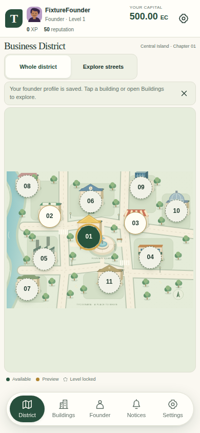
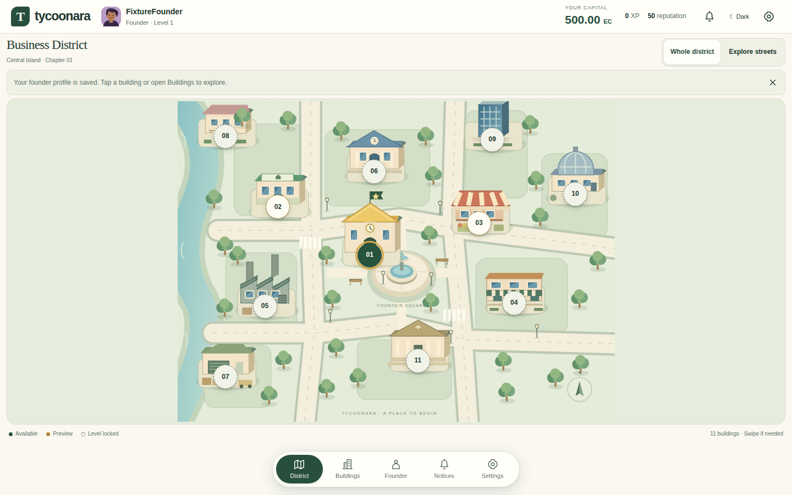

# Stage 1 — viewport shell and floating dock

Addresses the owner's [fixed viewport review](https://github.com/alexa-like/tycoonara/pull/2#issuecomment-6269092872) and [floating dock correction](https://github.com/alexa-like/tycoonara/pull/2#issuecomment-6269120514).

The game occupies the viewport with a compact persistent HUD and a full-width map workspace. The navigation is a floating bottom-centered pill on desktop and mobile: District, Buildings, Founder, Notices and Settings. There is no left rail or full-width bottom bar. Every dock target is at least 44px, with accessible names, an active indicator, keyboard focus and reduced-motion press feedback. Labels disappear first on very narrow or short screens. The dock floats 14px above the bottom safe area.

The map, toolbar, messages and zoom controls reserve dock clearance. The SVG and hotspots use the same coordinates at every zoom. Whole district fits all 11 targets on portrait phones; on short screens the minimum-size canvas pans internally to preserve touch targets. Explore streets retains native two-axis panning and bounded 100–150% zoom.

Buildings, Founder, Notices and Settings use a single accessible native dialog. Building details occupy the right side on desktop and a bottom sheet on phones; short landscape uses a larger overlay. Panel bodies scroll internally, the close control stays visible, and native modal inertness prevents dock interactions behind a panel. Escape/close restore focus and the explored map position. Settings contains theme preferences and the existing server-side sign-out action. A small dismissible tip replaces the large notice banner; the marketing footer is hidden only in the game.

## Before / after

| View | Before | After |
| --- | --- | --- |
| Phone 390, light | [Before](before-mobile-390x844-light.png) | [After](after-mobile-390x844-light.png) |
| Phone 390, dark | [Before](before-mobile-390x844-dark.png) | [After](after-mobile-390x844-dark.png) |
| Desktop 1440, light | [Before](before-desktop-1440x900-light.png) | [After](after-desktop-1440x900-light.png) |
| Desktop 1440, dark | [Before](before-desktop-1440x900-dark.png) | [After](after-desktop-1440x900-dark.png) |

## Panels and short screens

| View | Light | Dark |
| --- | --- | --- |
| Phone building details | [Details](after-mobile-390x844-light-building.png) | [Details](after-mobile-390x844-dark-building.png) |
| Building directory | [Buildings](after-mobile-390x844-light-buildings.png) | [Buildings](after-mobile-390x844-dark-buildings.png) |
| Founder and progression | [Founder](after-mobile-390x844-light-founder.png) | [Founder](after-mobile-390x844-dark-founder.png) |
| Notices | [Notices](after-mobile-390x844-light-notices.png) | [Notices](after-mobile-390x844-dark-notices.png) |
| Settings / account | [Settings](after-mobile-390x844-light-settings.png) | [Settings](after-mobile-390x844-dark-settings.png) |
| Mobile landscape | [Landscape](after-mobile-844x390-light.png) | [Landscape](after-mobile-844x390-dark.png) |
| Desktop building details | [Details](after-desktop-1440x900-light-building.png) | [Details](after-desktop-1440x900-dark-building.png) |
| Short laptop | [Laptop](after-desktop-1280x600-light.png) | [Laptop](after-desktop-1280x600-dark.png) |

## Verification scope

The browser matrix covers 320/360/390/430px phones, 844×390 and 667×320 landscape, 1440×900 desktop, 1280×600 short laptop and 720×450 reflow, in both themes. A separate CDP test models desktop browser zoom reflow from 100% through 200% using matching CSS viewport dimensions and device pixel ratio; physical browser zoom remains a manual acceptance check.

Checks cover no document scrolling, full-width map space, centered dock and safe-area clearance, target sizes, all five actions, active states, true touch and keyboard interactions, every building and directory entry, internal panel scrolling, modal inertness, rapid panel switching, focus return, Locate on map, saved map position, native touch panning, zoom alignment, theme switching, reduced motion and Axe WCAG rules. Safe-area spacing is checked with a simulated 20px bottom inset. Full real-local-Supabase signup/verification/onboarding/recovery/sign-out, RLS/ledger and concurrency regressions remain in CI.

Screenshots are unedited production-browser captures of a synthetic founder fixture. The before source is `d119ef866c2d7f1a3fc573d6e76506fbb6dc8a61`. No hosted accounts, tokens or private user data appear. No auth actions, database/RLS/ledger rules, grant semantics or hosted configuration were changed. No production release, merge or Stage 2 work was performed.

## Passing evidence

Tested application revision: `bd78df10773b553d96869e5fca447d199f5ea33e`. [All four final CI jobs passed](https://github.com/alexa-like/tycoonara/actions/runs/39269574056): lint, typecheck, production builds, dependency audit with zero vulnerabilities, four unit tests, SQL/RLS/immutable balanced ledger and concurrent-grant tests, plus 39 browser tests. The 33 intentional skips avoid running each viewport twice in both input projects. The subsequent screenshot-only commit changes no application code.

- [All 58 district before/after screenshots](https://github.com/alexa-like/tycoonara/actions/runs/39269574056/artifacts/12194117631), including full-page before images, all requested phone widths, landscape, short laptop, exploration and every panel.
- [Real local Supabase auth regression captures](https://github.com/alexa-like/tycoonara/actions/runs/39269574056/artifacts/12195686200).
- [Auth UI regression captures](https://github.com/alexa-like/tycoonara/actions/runs/39269574056/artifacts/12194866613).

Workflow artifacts expire after 30 days. The comparison images in this directory are committed for lasting review. The tested [Vercel preview](https://tycoonara-q8ub467be-hayatulahi24-5468.vercel.app/game) is READY. Physical Android, native browser zoom and screen-reader smoke checks remain manual; automated tests use Chromium emulation and Axe. Hosted SMTP/templates/redirect checks remain unverified, and prior protected-preview automation was denied by the Vercel integration's project/team scope (403). Existing release guards and deployment protection remain unchanged.
